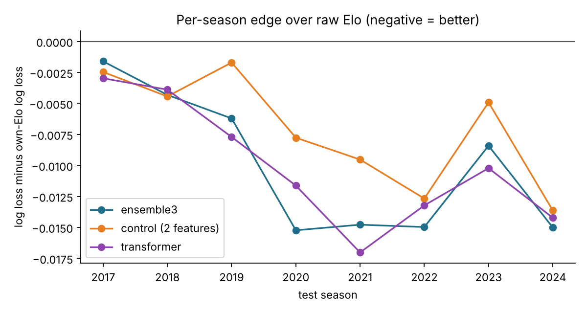
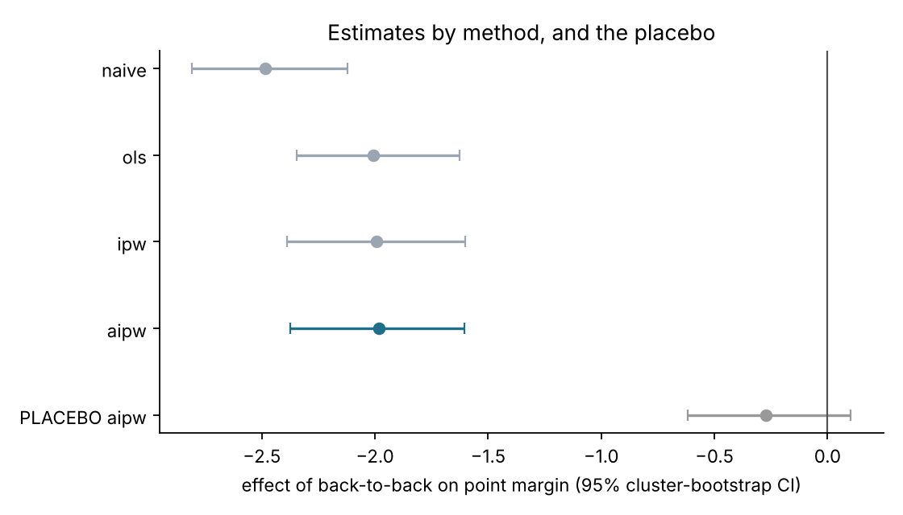

# NBA Game Predictor (PyTorch + scikit-learn)

Predict the probability that the home team wins an NBA regular-season game, using only information available before tipoff. Built to answer a specific question: **do neural networks beat a plain Elo rating system on this problem?** Short answer: not meaningfully, and the project is set up to show that honestly. It was then extended with unsupervised team-style clustering, a causal back-to-back analysis, a transformer encoder, and a walk-forward evaluation (see "Extensions" below).

Research data: [FiveThirtyEight NBA Elo dataset](https://github.com/fivethirtyeight/data/tree/master/nba-elo), 1946 to 2015, downloaded automatically. Regular season, NBA only: 55k games after dropping each team's first 10 games.

## Predicting upcoming games

The model scores a day's slate from results-based features (Elo, recent form, rest). It trains on 2011 to 2024 and needs fresh results to be useful, because Elo and form go stale fast.

```bash
pip install -r requirements.txt
python scripts/update_data.py                        # run on your own machine: pulls games through today via nba_api
python scripts/train_production.py                   # refit the ensemble on everything (about 15 s)
python scripts/predict_slate.py --date 2026-11-25    # schedule from the NBA's public JSON
python scripts/predict_slate.py --date 2026-11-25 --games "BOS@LAL,NYK@MIA"   # or type the slate, AWAY@HOME
```

The public history file ends April 2024, so `update_data.py` is required before predicting anything current. `predict_slate.py` refuses to run if the data is more than 3 days older than the slate date.

What to expect: about **64% of winners picked correctly** on held-out 2023 and 2024 games (always picking the home team gets 56%). That is the honest ceiling for a model that only sees results. It does not know about injuries, rest of specific players, or lineups, and it will lose to betting lines. Treat the output as a calibrated probability, not a lock.

Tested live on 2026-11-24: `update_data.py` pulled results through 2026-11-23 and `train_production.py` ran. The CDN schedule URL returned 403, so `predict_slate.py` now falls back to the `nba_api` scoreboard (the fallback was run live; the CDN path still has only synthetic-payload tests). If both fail, use `--games`.

## Setup

```bash
pip install -r requirements.txt
pytest -q tests                                       # leakage tests (about 2 seconds)
python scripts/run_experiment.py --seeds 1            # dev run, validation only (about 70 s)
python scripts/run_experiment.py --seeds 5 --final    # final run, adds test seasons + figures (about 4 min, CPU)
python scripts/walk_forward.py --seeds 3              # walk-forward 2017 to 2024 (about 14 min, CPU)
python scripts/style_analysis.py                      # team-style clustering
python scripts/causal_rest.py                         # back-to-back causal analysis
```

## Design

**Split is chronological.** Train: seasons up to 2009 (47,806 games). Validation: 2010 to 2011 (2,460). Test: 2012 to 2015 (4,679). Everything tunable (logreg C, number of trees, early stopping, temperature scaling) uses validation only. The test seasons are not evaluated without `--final`.

**Models** (each with and without Elo-based features):

| Model | What it is |
|---|---|
| `logreg` | Logistic regression, C picked on validation |
| `hist_gb` | Gradient-boosted trees, tree count picked on validation |
| `mlp` | PyTorch MLP (BatchNorm, GELU, dropout, AdamW, cosine decay, early stopping), 5 seeds, logits averaged |
| `seqnet` | PyTorch GRU reads each team's last 10 games (margin, win, home/away, rest, opponent strength, recency). Shared encoder for home and away, fused with tabular features. 5 seeds |
| `ENSEMBLE` | Mean probability of `hist_gb`, `mlp`, `seqnet` with Elo. Declared as the headline model before the test run |

NN logits are temperature-scaled on validation. **Benchmarks:** always predict the training home rate, 538's own published Elo forecast, and a control (below).

**Features** (all pre-game): last-10 and last-5 point margin, last-10 win rate, last-10 strength of schedule, season-to-date win rate and margin, games played, rest days, back-to-back flag, games in the last 7 days, pre-game Elo, home minus away differences, neutral-site flag, and the league home-win rate over the previous 1,500 games.

## Results (test seasons 2012 to 2015, 4,679 games)

| Model | Log loss | Brier | Accuracy | ECE | Log loss vs 538 (95% CI) |
|---|---|---|---|---|---|
| **Ensemble (hist_gb + mlp + seqnet, Elo)** | **0.5965** | 0.2054 | 67.3% | 0.018 | -0.0043 [-0.0072, -0.0016] |
| logreg (Elo) | 0.5968 | 0.2056 | 67.6% | 0.016 | -0.0040 [-0.0068, -0.0013] |
| seqnet (Elo) | 0.5969 | 0.2055 | 67.5% | 0.018 | -0.0039 [-0.0070, -0.0009] |
| mlp (Elo) | 0.5973 | 0.2057 | 67.3% | 0.013 | -0.0035 [-0.0068, -0.0004] |
| hist_gb (Elo) | 0.5975 | 0.2059 | 67.2% | 0.026 | -0.0032 [-0.0059, -0.0007] |
| Control: logreg on Elo gap + home rate only | 0.5988 | 0.2064 | 67.2% | 0.015 | -0.0020 [-0.0035, -0.0004] |
| 538 Elo forecast | 0.6008 | 0.2073 | 66.6% | 0.033 | reference |
| seqnet (no Elo) | 0.6029 | 0.2083 | 67.1% | 0.014 | +0.0021 [-0.0030, +0.0071] |
| mlp (no Elo) | 0.6050 | 0.2092 | 66.4% | 0.016 | +0.0042 [-0.0012, +0.0092] |
| hist_gb (no Elo) | 0.6053 | 0.2092 | 66.6% | 0.020 | +0.0045 [-0.0004, +0.0093] |
| logreg (no Elo) | 0.6108 | 0.2113 | 66.4% | 0.018 | +0.0100 [+0.0037, +0.0159] |
| Always home rate | 0.6799 | 0.2433 | 58.9% | 0.034 | +0.0791 |

Figures are in `results/`: test log loss, calibration, training curves, permutation importance.

## Modern era (2011 to 2024), the version used for predictions

The same pipeline on stats.nba.com-style game logs, with Elo computed from scratch (`src/nbapred/elo.py`; it tracks 538's published ratings within about 6 points). Train: seasons through 2021 (12,813 games). Validation: 2022 (1,230). Test: 2023 and 2024 (2,460). Test evaluated once. Benchmark is my own Elo forecast.

| Model | Log loss | Accuracy | ECE | Log loss vs Elo (95% CI) |
|---|---|---|---|---|
| seqnet (Elo) | 0.6262 | 64.0% | 0.018 | -0.0130 [-0.0202, -0.0057] |
| logreg (Elo) | 0.6265 | 64.4% | 0.026 | -0.0128 [-0.0183, -0.0070] |
| Ensemble (hist_gb + mlp + seqnet, Elo) | 0.6278 | 64.0% | 0.018 | -0.0114 [-0.0182, -0.0046] |
| mlp (Elo) | 0.6278 | 64.1% | 0.017 | -0.0114 [-0.0182, -0.0043] |
| Control: logreg on Elo gap + home rate only | 0.6303 | 63.9% | 0.019 | -0.0089 [-0.0135, -0.0045] |
| seqnet (no Elo) | 0.6308 | 63.0% | 0.022 | -0.0085 [-0.0176, +0.0004] |
| mlp (no Elo) | 0.6325 | 63.0% | 0.017 | -0.0067 [-0.0157, +0.0017] |
| hist_gb (Elo) | 0.6339 | 63.0% | 0.030 | -0.0054 [-0.0121, +0.0017] |
| hist_gb (no Elo) | 0.6349 | 62.2% | 0.037 | -0.0044 [-0.0136, +0.0048] |
| logreg (no Elo) | 0.6361 | 63.2% | 0.023 | -0.0031 [-0.0120, +0.0060] |
| Own Elo forecast | 0.6393 | 63.8% | 0.061 | reference |
| Always home rate | 0.6864 | 56.2% | 0.021 | +0.0471 |

Same story as the 1946 to 2015 run, only clearer. Raw Elo assumes home teams win 62.2% of the time; in 2023 and 2024 they won 56.2%. Re-fitting that one number (the control) gets most of the gain. Form and rest features add a little on top (ensemble vs control: -0.0025, CI [-0.0065, +0.0016], not distinguishable from zero). The neural nets match logistic regression (seqnet vs logreg: -0.0002, CI [-0.0033, +0.0029]), and gradient boosting is worst with only 12.8k training games. Every Elo-based model lands at 63 to 64% accuracy.

The deployed predictor averages logistic regression, gradient boosting and the MLP. Note the table's ensemble row is the one I declared before the test run, and it includes the GRU. I dropped the GRU from deployment afterwards because it added machinery without adding accuracy, so the exact three-model average was never scored on the test seasons. Its components are in the table; expect roughly 0.627 to 0.634 log loss.

## Extensions (modern era, 2011 to 2024)

Four additions, each with hypotheses written in the script docstring before the run. All of them mostly returned null results, and the write-up says so.

### Walk-forward evaluation (`scripts/walk_forward.py`)

One fixed split can flatter or punish a model by luck. This refits every model for each test season 2017 to 2024 (train through s-2, validate on s-1, test on s), 3 seeds for the NNs, 9,519 test games pooled. Paired bootstrap CIs on log loss.

| Model | Log loss | Accuracy | ECE | vs own Elo (95% CI) |
|---|---|---|---|---|
| transformer (Elo) | 0.6257 | 64.7% | 0.017 | -0.0100 [-0.0131, -0.0070] |
| Ensemble3 (logreg + hist_gb + mlp, Elo) | 0.6258 | 64.6% | 0.018 | -0.0099 [-0.0126, -0.0072] |
| logreg (Elo) | 0.6262 | 64.8% | 0.022 | -0.0095 [-0.0121, -0.0069] |
| logreg (Elo + style) | 0.6264 | 64.3% | 0.024 | -0.0093 [-0.0124, -0.0062] |
| GRU (Elo) | 0.6267 | 64.7% | 0.014 | -0.0090 [-0.0123, -0.0058] |
| mlp (Elo) | 0.6268 | 64.6% | 0.012 | -0.0089 [-0.0124, -0.0054] |
| Control: logreg on Elo gap + home rate | 0.6286 | 64.3% | 0.024 | -0.0071 [-0.0089, -0.0053] |
| hist_gb (Elo + style) | 0.6287 | 64.4% | 0.017 | -0.0070 [-0.0099, -0.0040] |
| hist_gb (Elo) | 0.6293 | 64.5% | 0.021 | -0.0064 [-0.0091, -0.0038] |
| Own Elo forecast | 0.6357 | 64.3% | 0.057 | reference |

Hypotheses, as declared, and what happened:

- **H1: style features add nothing.** Confirmed. Logreg with vs without style: +0.0002 [-0.0009, +0.0012]. MLP and gradient boosting also straddle zero.
- **H2: transformer ~ GRU ~ logistic regression.** Confirmed. Transformer vs GRU -0.0010 [-0.0022, +0.0003]; transformer vs logreg -0.0005 [-0.0022, +0.0011]. The transformer has the best point estimate and it is noise.
- **H3: the ensemble beats the control but not logistic regression.** Confirmed. Ensemble3 vs control -0.0028 [-0.0046, -0.0010]; vs logreg -0.0004 [-0.0015, +0.0007].

Net: re-fitting home-court advantage is worth about 0.0071 of the roughly 0.0100 total gain over raw Elo. The rest is real but small, and no architecture is distinguishable from logistic regression on 9.5k games.



### Transformer encoder (`TransNet` in `src/nbapred/models.py`)

Written from scratch: pre-norm blocks, a [CLS] token, learned positional embeddings over each team's last 10 games, shared encoder for home and away, fused with tabular features. Attention weights are extractable (`cls_attention`). The attention plot is nearly flat, rising only slightly toward older games (0.088 for the most recent game, 0.098 for the 10th back). Do not read that as "the model finds old games more informative." Flat attention here means the model has not learned a sharp recency pattern, which fits the result that Elo already summarizes the sequence.

### Unsupervised team styles (`scripts/style_analysis.py`, `src/nbapred/style.py`)

Nine per-game style rates (pace, three rate, free-throw rate, turnovers, rebounding, assists, steals, blocks), z-scored within season so league-wide drift (league three-point rate went from 0.22 in 2011 to 0.40 in 2024) does not become the clusters. PCA and KMeans/GMM on 420 team-seasons.

Honest result: **there are no real archetypes.** Silhouette is about 0.11 at k=3 versus a shuffled-column null of 0.08, BIC does not favor any k above 2, and cluster win rates (0.512, 0.500, 0.484) are not different (ANOVA p = 0.31). Held-out stability is moderate (ARI 0.78 +/- 0.11), which means the continuous axes are stable but the cut points are arbitrary. Styles are better described as a continuum than as clusters. Trailing style features (20-game window, shifted by one game, PCA fit on training rows only) did not improve any model (H1).

### Causal back-to-back effect (`scripts/causal_rest.py`, `src/nbapred/causal.py`)

Question: how much does playing on zero days of rest cost a team? Naive comparison is confounded: back-to-backs skew toward road games and tougher schedules. Estimators: naive, OLS adjustment, Hajek IPW, and AIPW (doubly robust), with propensity on team Elo, opponent Elo, home, opponent rest, and season progress. 31,943 team-games, 6,702 treated. Game-clustered bootstrap CIs (200 reps).

| Outcome | Naive | OLS | IPW | AIPW |
|---|---|---|---|---|
| Point margin | -2.49 | -2.01 | -1.99 | -1.98 [-2.37, -1.60] |
| Win probability | -7.2 pp | -5.7 pp | -5.6 pp | -5.6 pp [-6.8, -4.2] |

Covariate balance after weighting is good (all standardized mean differences under 0.02; the largest before weighting was home at -0.35). Estimates agree across methods, which is reassuring but not proof.

Caveats you should not skip:

- **The placebo is not clean.** Treating a team's *next* game's back-to-back status as the "treatment" should give zero. It gives -0.27 to -0.56 points (win rate about -1 to -2 pp), CIs mostly touching zero but not centered on it. That suggests residual confounding from scheduling, so the true effect is probably somewhat smaller than 2 points.
- **E-value 1.49** (CI bound 1.40). An unmeasured confounder associated with both treatment and outcome by a risk ratio of about 1.5 could explain the effect away. That is a modest bar.
- The effect is real in sign and plausible in size, but treat it as "roughly 1.5 to 2 points" not "-1.98."



### Learning material

`LEARN.md` has concept cards and 12 teach-back questions. `exercises/` has five stubs (Elo update, IPW, attention, temperature scaling, find-the-leak) with tests that skip until you implement them. `ex5_find_the_leak.py` fails on purpose until you fix the planted leak. Run `pytest exercises -q`.

## What the results actually say (1946 to 2015 run)

1. **The ensemble beats 538's forecast, and the gap is real** (CI excludes zero). But it is small: 0.0043 log loss, about 0.7 points of accuracy.
2. **About half of that gain is not modeling.** The control, a two-feature logistic regression, recovers 0.0020 of it. 538's Elo forecast hardcodes home-court advantage, and home advantage shrank over the decades, so 538 is miscalibrated on 2012 to 2015 (ECE 0.033 vs about 0.016). Concretely, 538's average forecast gives home teams a 62.1% win chance; they actually won 58.9%. Re-fitting that one number is most of the easy win.
3. **The extra 0.0023 from form, rest, and margin features is suggestive, not proven.** Ensemble vs control: -0.0023, 95% CI [-0.0049, +0.0001].
4. **The neural networks add nothing over logistic regression.** seqnet vs logreg: +0.0001 [-0.0014, +0.0016]. With about 48k training games and a low-signal target, depth has nothing to find. NN validation loss bottoms out within 1 to 16 epochs, which is the overfitting signature.
5. **Without Elo, the sequence model beats the other models** (0.6029 vs 0.6050 to 0.6108), and its CI vs 538 straddles zero. That is the one place the GRU's learned weighting of recent games plausibly helps, because it has to rebuild team strength from raw results. Still within noise.
6. Permutation importance (validation) says the Elo gap dominates by an order of magnitude. The next features, season margin and back-to-back, are about 20x smaller.

Process note: the test seasons were evaluated twice. The second run added only the control baseline; no model or hyperparameter changed, and the numbers for the other models were identical.

## Leakage tests

`tests/test_no_leakage.py` rewrites the results of every game on or after a cutoff day, including that day's own games, and asserts that features and sequences for all games up to and including the cutoff do not move. Rewriting only the strict future is not enough: a feature that peeks at its own game's result would pass. I confirmed the test fails when I deliberately inject that leak into `l10_wpct` or `season_wpct`. It also asserts that post-game columns (`elo_n`, `win_equiv`, `forecast`, scores) are never model inputs, and that sequences contain only earlier games from the same franchise.

## Limitations

- The 1946 to 2015 run does not cover the three-point era; the modern run (2011 to 2024) does, but its data ends April 2024 until you run `update_data.py`.
- The causal estimate is observational. The placebo test is not clean, so treat -2 points as an upper-end estimate.
- No betting odds. This predicts probabilities; it does not show an edge over a sportsbook, and nothing here says it would be profitable. Closing lines are the real benchmark and are far harder to beat than 538's Elo.
- No player-level data (injuries, lineups, rest of key players), which is where most real signal lives.
- The test set has 4,679 games, so differences under about 0.003 log loss are not detectable.

## Next steps worth doing

- Replace the benchmark with real closing lines (the market is the bar, not Elo).
- Add player availability features, then see if the GRU or transformer finally earns its keep. On results-only inputs, neither does.

## Layout

```
src/nbapred/   data.py, modern.py, elo.py, features.py, models.py, train.py, predict.py, metrics.py,
               style.py, causal.py
scripts/       run_experiment.py (--source 538|modern), train_production.py, update_data.py,
               predict_slate.py, make_figures.py, walk_forward.py, style_analysis.py, causal_rest.py
tests/         test_no_leakage.py, test_predict_path.py, test_style.py, test_causal.py, test_models.py
exercises/     5 implement-it-yourself stubs + tests (see LEARN.md)
results/       1946-2015 run, results/modern/, results/walk_forward/, results/style/, results/causal/
```

`tests/test_predict_path.py` proves the slate path (results unknown) produces exactly the features the backtest path would have, so what the model is scored on is what it sees in use. I confirmed it fails when I inject an Elo leak.
